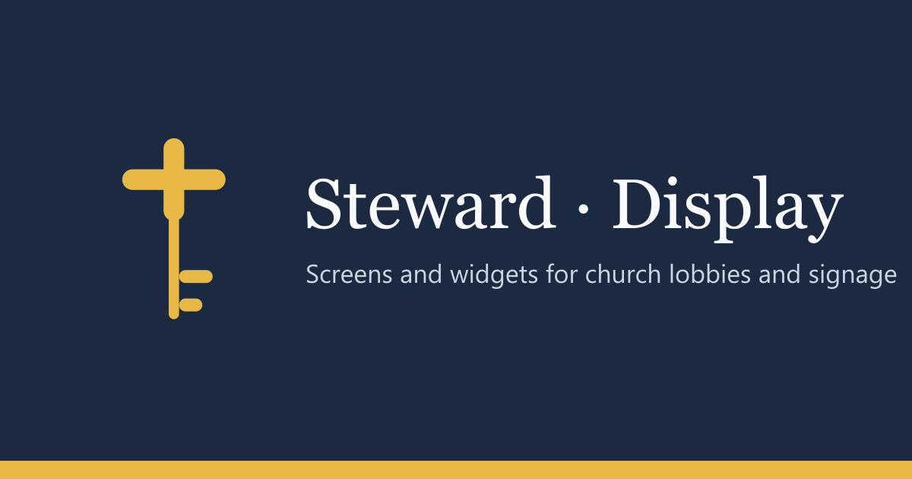

<div align="center">



<br><br>

<a href="https://github.com/24Skater/steward-display/actions/workflows/ci.yml"></a>
<a href="LICENSE"></a>


<br><br>

**[What it does](#what-it-does)** &nbsp;·&nbsp;
**[Quick start](#quick-start)** &nbsp;·&nbsp;
**[Status](#status)** &nbsp;·&nbsp;
**[Development](#development)**

</div>

<br>

Signage for churches. The lobby TV that shows the time, this week's announcements, a
countdown to the service and the building-fund thermometer, built by a volunteer on a laptop
and kept up to date from a phone.

Part of the [Steward](https://github.com/24Skater) family of open-source church tools.

## What it does

- **Screens** are full-screen layouts on a 12 × 12 grid, landscape or portrait, from 720p to
  4K.
- **Widgets** fill them: clock, date, announcement, countdown, scripture, giving progress,
  event list, text, image, video, weather and dividers.
- **The editor** is drag-and-drop with snapping, layout templates, presets and undo.
- **The Display View** is what the TV shows: no chrome, scaled to fit, Escape-free.

## Quick start

```sh
docker build -t steward-display .
docker run -d -p 3000:3000 steward-display
```

Open <http://localhost:3000>. Production setup (TLS, reverse proxy) is in
[docs/HOSTING.md](docs/HOSTING.md).

## Status

Pre-release. What works today, and what is next:

|                              |                                                                                                                                                             |
| ---------------------------- | ----------------------------------------------------------------------------------------------------------------------------------------------------------- |
| **Works**                    | Editor, widgets, templates, presets, import/export, Docker image, CI                                                                                        |
| **Limitation**               | No sign-in yet, and screens are stored in the browser that built them, so a TV cannot yet load a screen built on another device. Do not expose it publicly. |
| **Next: server and sign-in** | Postgres storage per church, sign-in (Steward SSO or local), TV pairing by code, offline cache on the TV, phone quick-edit for announcement text            |
| **Then: Steward platform**   | Provisioned and billed from the Steward console alongside Congregation, Table and VBS                                                                       |

## Development

Requires [Bun](https://bun.sh) 1.3+.

```sh
bun install
bun run dev          # http://localhost:8080
bun run lint
bun run typecheck
bun run build && bun run start
```

CI runs formatting, lint, typecheck, build, a Docker smoke test, the brand contrast audit and
the platform-boundary check (`scripts/ci/check-platform-boundaries.sh`).

### Brand

Colours, type and the Steward mark come from
[steward-brand](https://github.com/24Skater/steward-brand). Brand assets are bundled in
`public/` - the app never loads them from GitHub at runtime.

## Security

Report vulnerabilities privately: see [SECURITY.md](SECURITY.md).

## License

[MIT](LICENSE)
