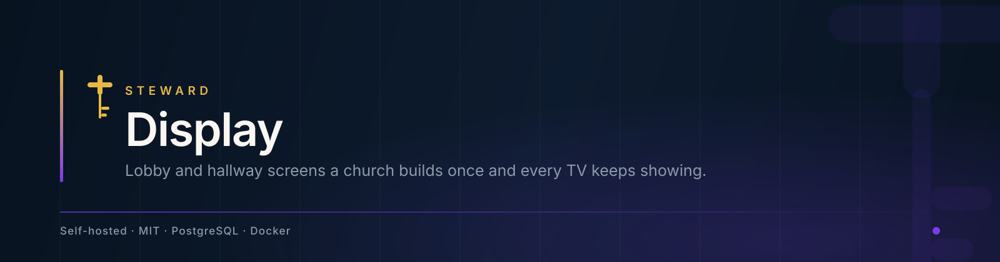

<div align="center">



<br><br>

<a href="https://github.com/24Skater/steward-display/actions/workflows/ci.yml"></a>
<a href="LICENSE"></a>


<br><br>

**[What it does](#what-it-does)** &nbsp;·&nbsp;
**[Quick start](#quick-start)** &nbsp;·&nbsp;
**[Status](#status)** &nbsp;·&nbsp;
**[Development](#development)** &nbsp;·&nbsp;
**[The Steward family](#the-steward-family)**

</div>

<br>

Signage for churches. The lobby TV that shows the time, this week's announcements, a
countdown to the service and the building-fund thermometer, built by a volunteer on a laptop
and kept up to date from a phone.

## What it does

- **Screens** are full-screen layouts on a 12 × 12 grid, landscape or portrait, from 720p to
  4K, saved to your church's account so everyone on the team edits the same ones.
- **Widgets** fill them: clock, date, announcement, countdown, scripture, giving progress,
  event list, text, image, video, weather and dividers.
- **The editor** is drag-and-drop with snapping, layout templates, presets and undo. Changes
  save on their own a moment after you stop.
- **TVs pair with a code.** Open `/tv` in the TV's browser, type the six-character code it
  shows into the TVs page, and pick its screen. No password on a TV remote.
- **The TV keeps going offline.** It remembers the last screen that loaded and shows it through
  network drops and reboots, and picks up edits within about 30 seconds of the network
  returning.

## Quick start

```sh
cp .env.example .env     # set POSTGRES_PASSWORD
docker compose up -d
```

Open <http://localhost:3000>. The first visit asks for a setup code (`docker compose logs app`
prints it), your church's name, and creates the owner's account. Production setup (TLS, backups, password resets) is in
[docs/HOSTING.md](docs/HOSTING.md).

## Status

Pre-release. What works today, and what is next:

|                            |                                                                                                                                                                                                                                                                  |
| -------------------------- | ---------------------------------------------------------------------------------------------------------------------------------------------------------------------------------------------------------------------------------------------------------------- |
| **Works**                  | Accounts, team invitations with roles, emailed password reset and confirmation, account deletion, Steward ID single sign-on, phone quick-edit, screens and presets on the server, TV pairing, offline TVs, editor, widgets, templates, import/export, Docker, CI |
| **Not yet**                | Weather data                                                                                                                                                                                                                                                     |
| **Next**                   | Open-Meteo weather                                                                                                                                                                                                                                               |
| **Then: Steward platform** | Provisioned and billed from the Steward console alongside Congregation, Table and VBS                                                                                                                                                                            |

## Development

Requires [Bun](https://bun.sh) 1.3+ and a Postgres 16 database. See
[docs/DEVELOPMENT.md](docs/DEVELOPMENT.md) for the database and tests.

```sh
bun install
bun run db:migrate   # applies migrations to DATABASE_URL from .env
bun run dev          # http://localhost:8080
bun run test         # unit tests; integration tests need TEST_DATABASE_URL
bun run lint && bun run typecheck && bun run build
```

CI runs formatting, lint, typecheck, unit and integration tests against Postgres, build, a
Docker smoke test against Postgres, the brand contrast audit and the platform-boundary check
(`scripts/ci/check-platform-boundaries.sh`).

### Brand

Colours, type and the Steward mark come from
[steward-brand](https://github.com/24Skater/steward-brand). Brand assets are bundled in
`public/` - the app never loads them from GitHub at runtime.

## The Steward family

Steward is five applications on one design system. Each one runs standalone and
self-hosted — nothing here requires the others, or us.

| Application                                                 | What it does                                 |
| ----------------------------------------------------------- | -------------------------------------------- |
| **[Congregation](https://github.com/24Skater/StewardChMS)** | Members, giving, worship planning, reporting |
| **[StewardPOS](https://github.com/24Skater/stewardpos)**    | Point of sale, inventory, returns            |
| **[Table](https://github.com/24Skater/steward-table)**      | Food orders, kitchen display, delivery       |
| **[VBS](https://github.com/24Skater/StewardVBS)**           | Registration, check-in, reporting            |
| **[Display](https://github.com/24Skater/steward-display)**  | Lobby screens, announcements, TV pairing     |

They share one design system — [Steward Brand](https://github.com/24Skater/steward-brand),
the tokens, components and icons every screen is built from.

## Security

Report vulnerabilities privately: see [SECURITY.md](SECURITY.md).

## License

[MIT](LICENSE)
